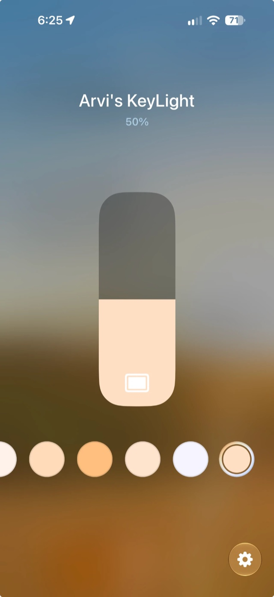
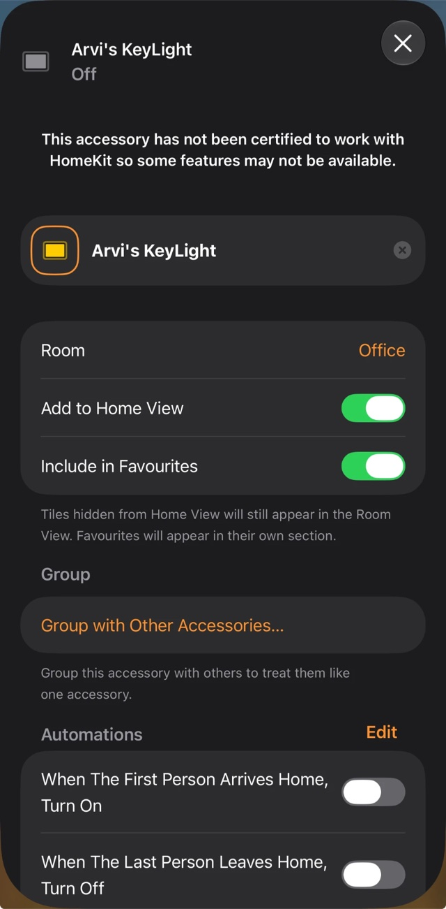

# elgato

Put your [Elgato Key Lights](https://www.elgato.com/us/en/p/key-light) in the Apple Home app, and control them from your Mac's terminal.

Key Lights don't support HomeKit on their own. `elgato` adds it: a small HomeKit bridge runs on your Mac, and your lights show up in the Home app next to your other accessories, ready for Siri, Control Center, scenes and automations. The same tool is also a fast command-line remote for your lights.

<p align="center">
  
  &nbsp;&nbsp;&nbsp;
  
</p>

## Add your Key Lights to Apple Home

### What you need

- **A Mac with Apple silicon** on macOS 13 Ventura or later, on the same network as your lights. The bridge runs on this Mac, so the Mac has to stay awake for the Home app to reach the lights. Intel Macs aren't tested yet.
- **An Elgato Key Light**, already set up on your Wi-Fi with Elgato's app. Tested with a Key Light Air. Elgato Light Strip isn't supported.
- **An iPhone or iPad** with the Home app, on the same Wi-Fi.
- Optional: a **home hub** (Apple TV or HomePod) to control the lights away from home and to run automations.

### 1. Install

```console
brew install arventures/elgato/elgato
```

Or, with Go 1.26 or later: `go install github.com/arventures/elgato@latest`.

### 2. Check that it finds your lights

```console
$ elgato list
NAME             SERIAL        HOST       PORT  FIRMWARE
Arvi's KeyLight  CW12A3B45678  10.0.0.11  9123  1.0.3
```

Nothing listed? Make sure the light is powered on and on the same network as your Mac, then run it again.

### 3. Start the bridge

```console
$ elgato homekit install
Found Arvi's KeyLight (10.0.0.11)
Adding a launchd daemon needs admin rights, so sudo may ask for your password.
Password:
Installed. The bridge is running and will start at every boot.
To add it: in the Home app tap + → Add Accessory → More options…, choose "Elgato Bridge" and enter 975-41-251.
Log: /Users/you/Library/Logs/elgato-homekit.log
```

This sets the bridge up as a background service that starts with your Mac, which is why it asks for your password once. macOS may show a **Background Items Added** notification: that's the bridge, so leave it allowed.

Note your **setup code**, the 8 digits near the end. Yours will be different.

### 4. Add the bridge in the Home app

1. On your iPhone, open **Home**, tap **+** and choose **Add Accessory**.
2. Tap **More options…** and pick **Elgato Bridge** (it may appear as `Elgato_Bridge`).
3. Enter the setup code from step 3.
4. When the Home app warns that the accessory is uncertified, tap **Add Anyway**. It says that about any accessory outside Apple's MFi program.
5. Choose a room and a name for each light.

That's it. Try "Hey Siri, turn on the key light", or touch and hold the light in the Home app to set its brightness and color temperature.

### Good to know

- **Keep the Mac awake.** The Home app reaches your lights through the bridge, so while your Mac sleeps or is off, the lights show **No Response**. On a MacBook, closing the lid puts it to sleep; keep it plugged in with the lid open, and turn on System Settings → Battery → Options → *Prevent automatic sleeping on power adapter when the display is off*. For lights that always respond, run the bridge on a Mac that stays on, like a Mac mini.
- **Changes sync both ways.** Changes from Elgato's app, the command line or the light's own button show up in the Home app within a few seconds.
- **Every light is added.** To add just one, install with `elgato --light "<name>" homekit install`.
- **After upgrading** with `brew upgrade elgato`, run `elgato homekit install` again to restart the bridge on the new version. You stay paired.
- **Privacy:** the bridge works entirely on your local network. The Home app talks to it over HomeKit's encrypted protocol, and only devices you pair can control your lights.

### Troubleshooting

- **The bridge isn't listed under More options….** Check that your iPhone is on the same Wi-Fi as your Mac, then look at the log: `tail ~/Library/Logs/elgato-homekit.log`. If the bridge was added to a home before, see *Start over* below.
- **The lights show No Response.** Usually the Mac is asleep or a light is unplugged. If a light's IP address changed, run `elgato homekit install` again to restart the bridge. A DHCP reservation for the light on your router keeps its address fixed.
- **The log says `no route to host`.** Right after installing, macOS can block the bridge's very first request. The bridge retries every few seconds, and the next line should read `responding again`. If it keeps failing, run `elgato homekit install` again.
- **Start over** (for example, you removed the bridge from Home while the Mac was off, and now it won't pair): run `elgato homekit uninstall`, delete `~/.config/elgato/homekit`, then run `elgato homekit install` and pair again with the new code.

### Remove it

1. In the Home app, open a light's settings, tap **Bridge** and choose **Remove Bridge from Home**.
2. On your Mac, run `elgato homekit uninstall`.
3. To forget the pairing as well, delete `~/.config/elgato/homekit`.

### How it works

`elgato homekit` is a HomeKit Accessory Protocol (HAP) bridge built on [brutella/hap](https://github.com/brutella/hap).

- Each light becomes a HomeKit lightbulb with on/off, brightness and color temperature. Elgato and HomeKit both measure color temperature in mireds, so 2900–7000K maps one-to-one.
- The bridge reads each light every 3 seconds, so changes made elsewhere reach the Home app, and the Home app never drops a tap because it held an old value.
- `install` adds a launchd daemon, `/Library/LaunchDaemons/ventures.ar.elgato.homekit.plist`, that runs `elgato homekit` as your user. It's a daemon rather than a login item because macOS's Local Network privacy blocks launchd agents from reaching devices on your network but lets daemons through ([TN3179](https://developer.apple.com/documentation/technotes/tn3179-understanding-local-network-privacy)).
- The pairing keys, the setup code and each light's HomeKit ID live in `~/.config/elgato/homekit`. Lights are tracked by serial number, so rooms and automations survive restarts.
- To run the bridge in the foreground instead, use `elgato homekit`. Its flags: `--code` to choose your own setup code, `--listen` for the server address (default `:51827`) and `--poll` for the sync interval (default `3s`).

## Use it from the command line

```console
$ elgato on
$ elgato brightness 70
$ elgato temp 4500
$ elgato off
```

Lights are found automatically on your network, with no IP addresses to remember.

| Command | What it does |
| --- | --- |
| `elgato on` | Turn lights on |
| `elgato off` | Turn lights off |
| `elgato toggle` | Toggle power |
| `elgato brightness 50` | Set brightness to 50% |
| `elgato brightness +10` | Raise brightness by 10% (also `-10`) |
| `elgato temp 4500` | Set color temperature to 4500K |
| `elgato status` | Show current state |
| `elgato list` | Discover lights and refresh the cache |
| `elgato homekit install` | Put your lights in the Apple Home app ([above](#add-your-key-lights-to-apple-home)) |

Global flags (work on any command):

| Flag | Purpose |
| --- | --- |
| `--host 10.0.0.11` | Target a light directly by IP, skipping discovery |
| `-l, --light <name>` | Act on a single light (by name or serial) |
| `--refresh` | Force mDNS discovery instead of using cached addresses |
| `--json` | Machine-readable output |
| `--color auto\|always\|never` | When to show the temperature color swatch (default `auto`) |
| `--timeout 2s` | How long to browse for lights |

By default a command acts on **all** lights it finds. Use `--light` to narrow to one.

Shell completion is available via `elgato completion <bash|zsh|fish>` (Homebrew installs it automatically).

### Temperature color swatch

Every command that prints state (`status`, `on`, `temp`, …) shows a `COLOR` column with the approximate on-screen color of the light's color temperature — warm amber down near 2900K, a cool bluish white up near 7000K — alongside its `#rrggbb` hex value:

```text
NAME             HOST       POWER  BRIGHTNESS  TEMPERATURE  COLOR
Arvi's KeyLight  10.0.0.11  on     50%         4700K        ███ #ffdec3
```

The swatch uses 24-bit ("truecolor") ANSI and is shown only when writing to a terminal. It is suppressed automatically when piping output, when the [`NO_COLOR`](https://no-color.org) environment variable is set, or with `--color never`; force it on with `--color always`. The `--json` output includes the value as a `color` field.

### How it finds your lights

1. **Cache first.** Known lights are remembered in `~/.config/elgato/config.yaml`, keyed by their **serial number** (stable across reboots and DHCP changes). Cached addresses are tried first, so everyday commands are instant.
2. **mDNS discovery.** If nothing is cached or reachable, the tool browses the network for the `_elg._tcp` service Elgato lights advertise, then refreshes the cache. Run `elgato list` (or add `--refresh`) any time to re-scan.
3. **Direct.** `--host <ip>` bypasses all of the above.

### Config file

`~/.config/elgato/config.yaml` is created automatically. You can edit it to give lights friendlier names:

```yaml
lights:
  key-left:
    serial: CW12A3B45678   # stable identity, from `elgato list`
    host: 10.0.0.11        # last known address (auto-refreshed)
    port: 9123
discovery_timeout: 2s
```

Then: `elgato --light key-left on`.

### About color temperature

Elgato's API takes temperature as a "mired" value in the range `143`–`344`. This tool lets you use Kelvin instead and converts for you (`mireds = 1,000,000 ÷ Kelvin`). The usable range is roughly **2900K (warm)** to **7000K (cool)**; values outside are clamped.

## Development

```console
go build ./...      # compile
go test ./...       # run unit tests (no device needed)
go vet ./...
```

The pure logic (Kelvin↔mireds conversion, brightness parsing, request shape) lives in `internal/elgato` and is unit-tested without hardware. Network code (HTTP client, mDNS) is isolated in `internal/elgato` and `internal/discovery`. The HomeKit bridge lives in `internal/homekit` and is tested against a fake light served by `httptest`.

## Releasing (maintainers)

Releases are automated with [GoReleaser](https://goreleaser.com) via GitHub Actions. One-time setup:

1. Create a second GitHub repo named **`homebrew-elgato`** (this is the tap).
2. Create a fine-grained personal access token with access to only that tap repo and **Contents: Read and write**. Save it to **this** repo as the Actions secret **`TAP_GITHUB_TOKEN`**:

   ```console
   gh secret set TAP_GITHUB_TOKEN --repo arventures/elgato
   ```

   It prompts for the value, so the token never lands in your shell history.

Then cut a release by pushing a tag:

```console
git tag v0.3.0
git push origin v0.3.0
```

The workflow builds macOS/Linux binaries (Intel + Apple silicon), publishes a GitHub Release, and pushes an updated Homebrew **cask** to the tap (Homebrew now prefers casks for pre-built binaries; casks are macOS-only). Validate config locally with `goreleaser check` and dry-run with `goreleaser release --snapshot --clean`.

## Disclaimer

This is an unofficial, community project and is not affiliated with or endorsed by Corsair or Apple. Elgato, Key Light, Apple, HomeKit and Siri are trademarks of their respective owners.

## License

[MIT](./LICENSE)
